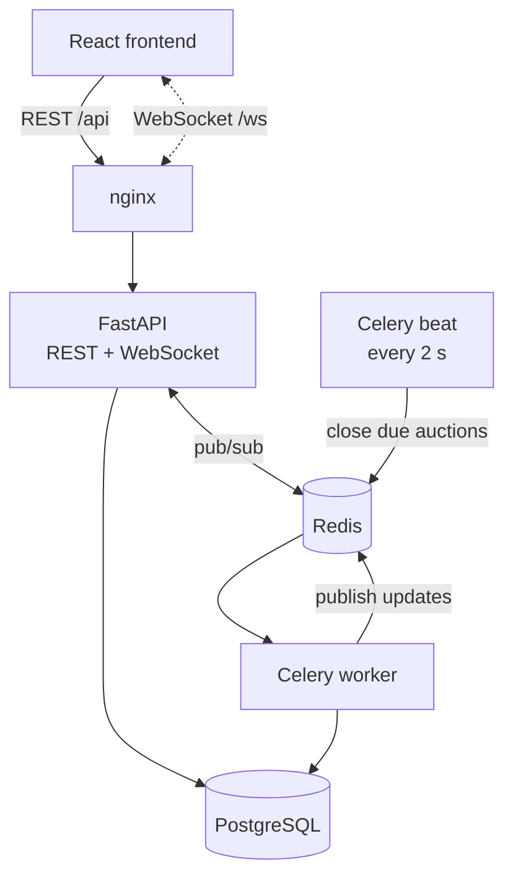

# High-Level Design

## Overview

A buyer creates an RFQ that runs as a British (reverse) auction. Suppliers submit quotes and
keep lowering their price. If a qualifying bid comes in during the last **X** minutes, the bid
close time is extended by **Y** minutes, but never past the **forced close time**.

## Architecture

- **Frontend**: React + TypeScript (Vite). Uses REST for data and a WebSocket to know when
  something changed, then refetches.
- **Backend**: FastAPI. The auction rules are in `app/auction/engine.py`; all writes go
  through `app/auction/service.py`.
- **PostgreSQL**: users, RFQs, bids and the activity log (see [SCHEMA.md](SCHEMA.md)).
- **Redis**: Celery broker, plus pub/sub so every API instance can push live updates.
- **Celery**: beat runs a task every 2 seconds that marks ended auctions as closed and logs it.
  The worker also runs the demo bidding bots.

## Placing a bid

1. Lock the RFQ row (`SELECT ... FOR UPDATE`) so bids on the same auction are handled one at a time.
2. Reject the bid if bidding hasn't started or the current close time has passed.
3. The new total (freight + origin + destination) must be lower than the supplier's previous best.
4. Rank suppliers before and after the bid. If the bid is in the last X minutes and the trigger
   condition is met, set `close = min(close + Y, forced_close)`.
5. Save the bid and the activity log entries, commit, then publish an update to Redis.

Extension triggers:

| Trigger | Extends when |
|---|---|
| Bid received in last X min | any valid bid arrives in the window |
| Any rank change in last X min | the bid changes any supplier's position |
| L1 change in last X min | the lowest bidder changes |

## Auction status

Status is calculated from the stored times, not saved:

- **Upcoming**: before the bid start time
- **Active**: between bid start and the current close time
- **Closed**: ended at its (possibly extended) close time
- **Force Closed**: extensions reached the forced close time and it ended there

## Assumptions

- An extension adds Y minutes to the current close time (6:00 PM → 6:05 PM, as in the example).
  If less than Y minutes are left before the forced close, it only extends up to the forced close.
- Ranking is by total price. Each supplier's lowest bid counts; on a tie, the earlier bid wins.
- A supplier can only lower their own price. They don't have to beat L1.
- A supplier entering the ranking for the first time counts as a rank change.
- Suppliers see their own rank and the L1 price, not other suppliers' names or quotes.
- There is no login. A user switcher in the header sends the selected user as `X-User-Id`.

## API

| Method | Endpoint | Description |
|---|---|---|
| GET | `/api/rfqs` | Auction list |
| POST | `/api/rfqs` | Create RFQ (buyer) |
| GET | `/api/rfqs/{id}` | Auction details |
| POST | `/api/rfqs/{id}/bids` | Submit quote (supplier) |
| POST | `/api/rfqs/{id}/award` | Award a quote after closing (buyer) |
| GET | `/api/metrics` | Bids per RFQ and price improvement (buyer) |
| POST | `/api/demo/auctions` | Start a demo auction with bots (buyer) |
| GET | `/api/users` | Users for the switcher |
| WS | `/ws/rfqs` | Live update notifications |

Full API docs: `http://localhost:8000/docs`.
