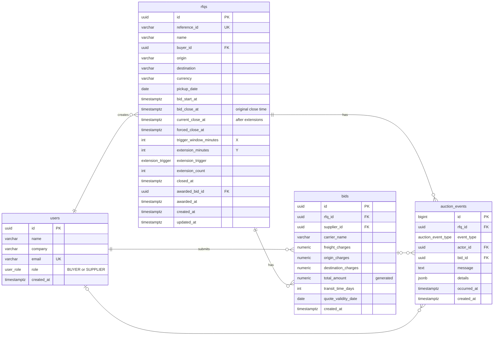

# Database Schema

PostgreSQL. Migrations are managed with Alembic (`backend/alembic`).

## Tables

- **users**: buyers and suppliers.
- **rfqs**: one row per RFQ / auction. `bid_close_at` keeps the original close time and
  `current_close_at` moves when the auction is extended. `closed_at` is set by the Celery task
  once the close is logged.
- **bids**: one row per quote. `total_amount` is a generated column
  (`freight_charges + origin_charges + destination_charges`).
- **auction_events**: activity log. Bids, extensions (with the reason), closes and awards.
  `details` holds structured data such as the old and new close time.

## Enums

- `user_role`: `BUYER`, `SUPPLIER`
- `extension_trigger`: `BID_RECEIVED`, `ANY_RANK_CHANGE`, `L1_RANK_CHANGE`
- `auction_event_type`: `RFQ_CREATED`, `BID_PLACED`, `AUCTION_EXTENDED`, `EXTENSION_CAPPED`,
  `AUCTION_CLOSED`, `AUCTION_FORCE_CLOSED`, `AUCTION_AWARDED`

## Constraints

- `forced_close_at > bid_close_at > bid_start_at`
- `bid_close_at <= current_close_at <= forced_close_at` (extensions can't go past the forced close)
- `trigger_window_minutes > 0`, `extension_minutes > 0`
- charges `>= 0`, `transit_time_days > 0`

## Indexes

- `bids (rfq_id, total_amount, created_at)`: ranking and lowest bid per RFQ
- `bids (rfq_id, supplier_id, created_at)`: a supplier's bids on an RFQ
- `rfqs (current_close_at) WHERE closed_at IS NULL`: used by the close task
- `auction_events (rfq_id, occurred_at, id)`: activity log
